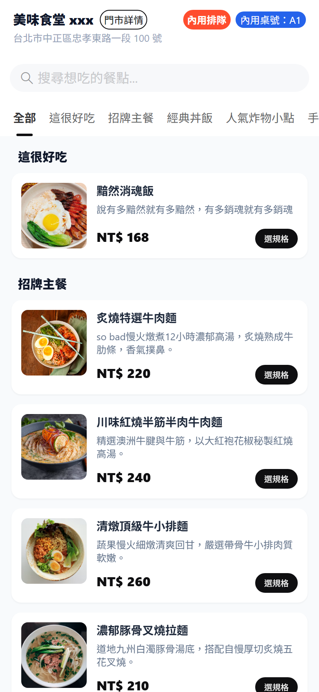
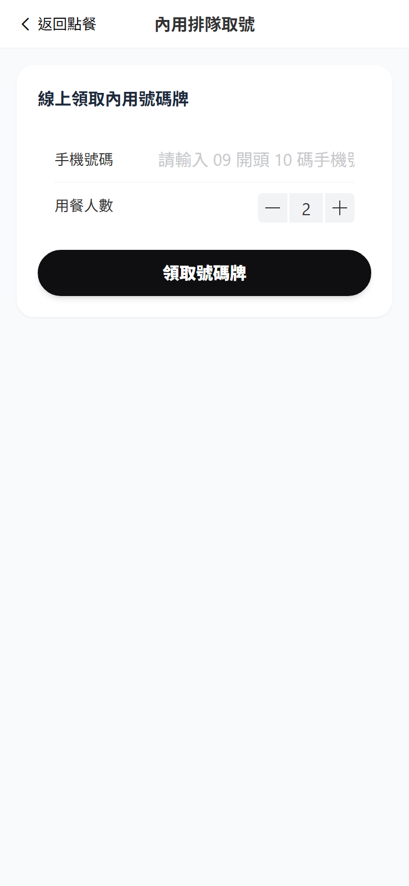
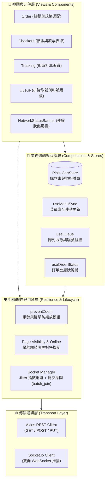

# 📱 QR Dine Client - 顧客智慧點餐與排隊端

> 專為行動瀏覽器（iOS Safari / Android Chrome）量身打造的高效、極簡 QR Code 掃碼點餐與排隊叫號 H5 應用。

---

## 📸 介面畫面展示 (Screenshots)

<div align="center">
  <table>
    <tr>
      <td align="center">
        <b>🍜 點餐與菜單規格選配</b><br><br>
        
      </td>
      <td align="center">
        <b>📢 內用排隊取號與即時叫號</b><br><br>
        
      </td>
    </tr>
  </table>
</div>

---

## 🏛️ 前端分層架構與資料流 (Architecture & Data Flow)

客戶端採用清晰的**關注點分離（Separation of Concerns）**分層架構，並在傳輸層與視圖層之間設計了專屬的**高可用韌性層（Resilience Layer）**，確保在行動端弱網或休眠環境下仍能自癒運作：



### 雙軌狀態同步機制 (Dual-track Data Synchronization)
1. **即時推播軌（Push Track）**：平時透過持久化 WebSocket 接收廚房接單、出餐完成、過號唱號等事件，畫面毫秒級響應。
2. **喚醒對帳軌（Pull/Reconcile Track）**：當顧客將手機鎖屏放入包包（連線斷開），再度解鎖喚醒時，`Page Visibility API` 自動觸發重連，並主動呼叫 REST API 重新拉取一次最新訂單與叫號快照，徹底避免因背景中斷而漏接推播。

---

## 📂 專案目錄結構 (Directory Structure)

```text
client/
├── docs/screenshots/     # README 介面截圖資源
├── src/
│   ├── api/              # Axios HTTP 實例與請求攔截封裝
│   ├── components/       # 高覆用 UI 元件（購物車抽屜、菜單卡片、狀態膠囊等）
│   ├── composables/      # 業務邏輯封裝（菜單同步、排隊管理、狀態轉換）
│   ├── locales/          # Vue I18n 多語系字典（繁中 / 英文）
│   ├── router/           # Vue Router 路由配置
│   ├── stores/           # Pinia 狀態（購物車 cartStore）
│   ├── types/            # 全域 TypeScript 型別定義
│   ├── utils/            # 模組化工具函式（防縮放 preventZoom 等）
│   ├── views/            # 頁面級視圖（點餐、結帳、追蹤、排隊、付款）
│   ├── App.vue           # 根組件（掛載頂部狀態列與全域監聽）
│   ├── main.ts           # 程式入口點（外掛與防縮放初始化）
│   ├── socket.ts         # Socket.io 核心連線、批次房間與重連退避管理
│   └── style.css         # Tailwind 指令與 Vant 主題變數覆寫
├── index.html            # 簡潔純粹的 HTML 骨架（含 viewport 規範）
└── vite.config.ts        # Vite 構建與本地 /api, /socket.io 反向代理配置
```

---

## ✨ 核心特色與亮點

- 🎨 **現代極簡潮流風格**：採用碳黑底膠囊按鈕、電光橘紅 (`#ff4d2e`) 與冷鈷藍 (`#2563eb`) 點綴，支援多語系切換。
- 🛡️ **行動端體驗強化**：
  - **防誤觸與防縮放**：零依賴模組化攔截 iOS 雙指捏合、多指觸控滑動、非互動空白區雙擊縮放（`preventZoom.ts`），輸入框自動強制 16px 避免鍵盤彈起時畫面變形。
  - **斷線高可用自癒**：支援隨機抖動退避（Jitter）、`Page Visibility API` 喚醒對帳補齊、批次房間恢復（`batch_join`）。
  - **無感狀態提示**：斷線時頂部懸浮半透明膠囊「⚡ 網路連線中斷，正在為您重新連線...」，重連成功平滑淡出。
- ⚡ **即時同步與叫號**：
  - 店家下架/改價即時推播，購物車聯動自動剔除或調價通知。
  - 內用排隊取號、即時叫號震動提醒、3 次唱號未到自動取消保護。
- 💳 **彈性結帳流程**：支援內用桌號、外帶模式、統編/手機條碼載具驗證、現場付現與線上模擬付款。

---

## 🛠️ 技術棧 (Tech Stack)

- **核心框架**：Vue 3 (Composition API, `<script setup>`)
- **程式語言**：TypeScript
- **構建工具**：Vite 8
- **狀態管理**：Pinia
- **UI 元件庫**：Vant 4 + Tailwind CSS
- **即時通訊**：Socket.io-client 4.8
- **表單校驗**：Zod
- **國際化**：Vue I18n
- **自動化測試**：Playwright E2E

---

## 🚀 快速開始 (Getting Started)

### 1. 安裝依賴
```bash
npm install
```

### 2. 啟動開發伺服器（支援區域網路 / 手機連線）
```bash
npm run dev
```
* 本機存取：`http://localhost:5173/`
* 手機 Wi-Fi 存取：`http://[你的本機IP]:5173/`（例如 `http://192.168.0.119:5173/`）

### 3. 執行自動化測試
```bash
npm test
```

### 4. 正式打包建置
```bash
npm run build
```
